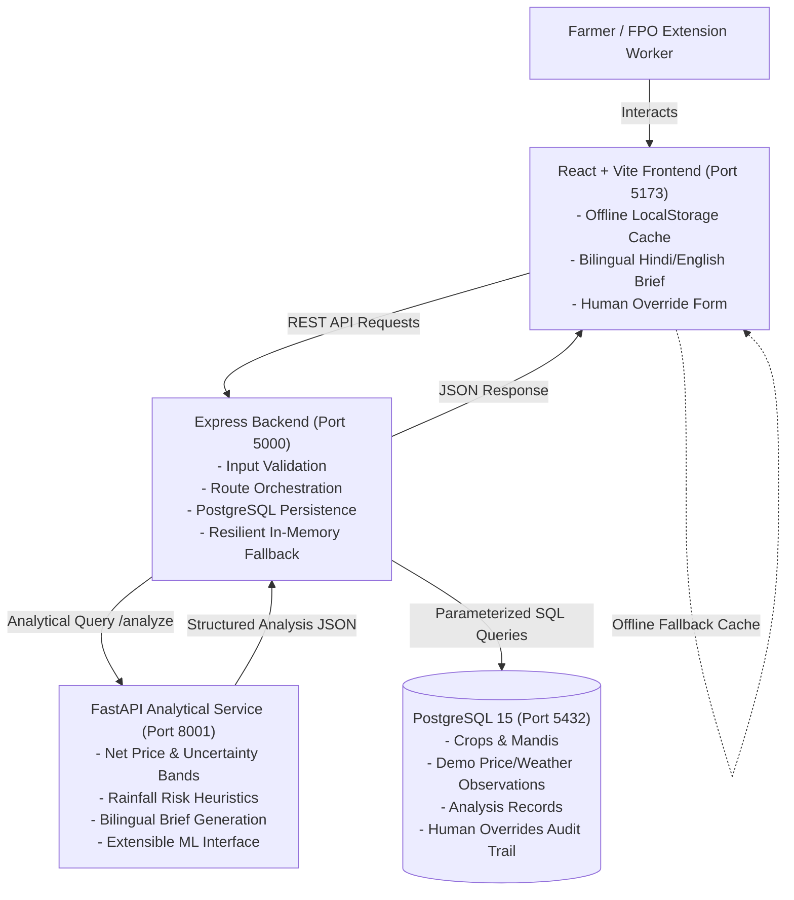

# FasalWindow — The 36-Hour Harvest Decision Co-Pilot

> **Offline-first, uncertainty-aware harvest and market decision-support system for smallholder farmers.**

[](https://nodejs.org/)
[](https://www.python.org/)
[](https://fastapi.tiangolo.com/)
[](https://react.dev/)
[](https://www.postgresql.org/)

---

## 1. Problem Statement & Motivation

Smallholder farmers in India frequently face tight **24–48 hour harvest windows** where deciding when to cut standing crops and which regional mandi (market) to sell at significantly impacts household survival:

1. **The Nominal Price Illusion:** A distant mandi quoting a higher nominal rate often yields lower net income once tractor-trolley haulage costs are deducted.
2. **Short-Term Weather Hazards:** Sudden unseasonal rainfall can cause moisture damage, grain blackening, or open auction yard waterlogging.
3. **Rural Connectivity Gaps:** Real-time cellular coverage in field clusters is notoriously erratic.
4. **Extension Worker Trust & Agency:** Local extension officers (Kisan Mitras) and FPO coordinators understand physical field barriers (flooded culverts, trusted commission agents) that algorithms cannot perceive.

**FasalWindow** provides an honest, transparent decision co-pilot. It evaluates net price realization per kilogram, assesses short-term rainfall risk heuristics, preserves price ranges, works offline, generates deterministic bilingual Hindi/English briefs, and logs auditable human overrides.

---

## 2. Core Features

- **Net Realization Arithmetic:** Strict formula: $\text{Net Realization (₹/kg)} = \text{Gross Mandi Price (₹/kg)} - \text{Transport Cost (₹/kg)}$.
- **Rigorous Unit Consistency:** Normalizes to INR/kg. Flags ambiguous total vehicle trip costs when lot quantity is omitted.
- **Price Range Preservation:** Retains $[G_{\min} - T, G_{\max} - T]$ bounds without misleading averaging.
- **Conflicting Quote Safeguards:** Discrepancies exceeding 10% between traders and official boards are flagged with full spread preserved.
- **Rainfall Risk Meter:** Transparent thresholds for dry/favorable ($0\text{--}2\text{ mm}$), moderate showers ($2.1\text{--}10\text{ mm}$ with tarp advice), and heavy rainfall ($>10\text{ mm}$ with proximity trade-offs).
- **Stale & Missing Weather Handling:** Forecasts $>12\text{h}$ old are tagged as stale; missing forecasts fall back gracefully to price-only analysis.
- **Deterministic Bilingual Briefs:** Field-ready decision briefs in **Hindi (Devanagari)** and **English** with zero third-party paid AI API dependency.
- **Offline-First Resilience:** Client-side caching of the latest verified advisory and offline queueing of overrides.
- **Auditable Human Overrides:** Field workers can override algorithmic rankings with a mandatory recorded reason, stored in PostgreSQL.
- **Zero Fabricated AI Claims:** Transparent mathematical baseline with modular interfaces ready for genuine machine learning models.

---

## 3. Technology Stack

- **Frontend:** React 18, Vite, JavaScript, Custom Vanilla CSS Design System, Lucide Icons.
- **Backend API Gateway:** Node.js 24, Express.js 4.19, `pg` (PostgreSQL client), `axios`.
- **Analytical & ML Engine:** Python 3.13, FastAPI, Pydantic 2, Uvicorn, Pytest.
- **Database:** PostgreSQL 15 (relational persistence, indexes, foreign keys).

---

## 4. System Architecture



---

## 5. Mandatory Folder Structure

```text
F:\IIIT_Gwalior_Hackathon\
├── frontend\
│   ├── public\
│   ├── src\
│   │   ├── components\
│   │   │   ├── Navbar.jsx
│   │   │   ├── HarvestInputForm.jsx
│   │   │   ├── MandiComparison.jsx
│   │   │   ├── RainfallRiskCard.jsx
│   │   │   ├── DecisionBrief.jsx
│   │   │   ├── WarningBanner.jsx
│   │   │   ├── CachedIndicator.jsx
│   │   │   └── HumanOverrideModal.jsx
│   │   ├── services\
│   │   │   └── api.js
│   │   ├── App.jsx
│   │   ├── main.jsx
│   │   └── index.css
│   ├── package.json
│   ├── vite.config.js
│   └── index.html
│
├── backend\
│   ├── src\
│   │   ├── config\
│   │   │   └── db.js
│   │   ├── controllers\
│   │   │   ├── analysisController.js
│   │   │   ├── overrideController.js
│   │   │   └── catalogController.js
│   │   ├── services\
│   │   │   └── fastapiClient.js
│   │   ├── middleware\
│   │   │   └── errorHandler.js
│   │   ├── routes\
│   │   │   └── api.js
│   │   ├── app.js
│   │   └── server.js
│   ├── tests\
│   │   └── api.test.js
│   ├── package.json
│   └── .env.example
│
├── ML\
│   ├── app\
│   │   ├── __init__.py
│   │   ├── schemas.py
│   │   ├── pricing.py
│   │   ├── rainfall_risk.py
│   │   ├── recommendations.py
│   │   └── main.py
│   ├── tests\
│   │   └── test_analytics.py
│   ├── requirements.txt
│   └── .env.example
│
├── database\
│   ├── schema.sql
│   └── seed.sql
│
├── docs\
│   ├── architecture.md
│   ├── architecture-diagram.mmd
│   ├── wireframes.md
│   ├── pseudocode.md
│   ├── api-documentation.md
│   └── assumptions-and-limitations.md
│
├── tests\
│   └── acceptance-tests.md
│
├── .gitignore
└── README.md
```

---

## 6. Prerequisites

- **Node.js:** v18.0.0 or higher (v24.x recommended)
- **Python:** v3.10 or higher (v3.13 recommended)
- **PostgreSQL:** v14 or higher (v15 running on port 5432)

---

## 7. Installation & Setup

### 7.1 Clone & Navigate
```powershell
cd F:\IIIT_Gwalior_Hackathon
```

### 7.2 Python FastAPI Analytical Service
```powershell
# Navigate to ML directory
cd ML

# Install dependencies
python -m pip install -r requirements.txt

# Copy environment variables
cp .env.example .env

cd ..
```

### 7.3 Node.js Express Backend
```powershell
# Navigate to backend directory
cd backend

# Install dependencies
npm install

# Copy environment variables
cp .env.example .env

cd ..
```

### 7.4 React Frontend
```powershell
# Navigate to frontend directory
cd frontend

# Install dependencies
npm install

cd ..
```

### 7.5 PostgreSQL Database Setup
Create database `fasalwindow` in PostgreSQL and initialize schema and seed data:

```powershell
# Using psql command line:
psql -U postgres -c "CREATE DATABASE fasalwindow;"
psql -U postgres -d fasalwindow -f database/schema.sql
psql -U postgres -d fasalwindow -f database/seed.sql
```

*(Note: If PostgreSQL is offline or credentials are not yet configured, the Express backend automatically runs in resilient in-memory mode without crashing).*

---

## 8. Running the Application

Open three separate terminal windows:

### Terminal 1: Python FastAPI Service (Port 8001)
```powershell
cd F:\IIIT_Gwalior_Hackathon\ML
python -m uvicorn app.main:app --host 127.0.0.1 --port 8001 --reload
```
*Health check:* http://127.0.0.1:8001/health  
*Interactive Swagger docs:* http://127.0.0.1:8001/docs

### Terminal 2: Express.js Backend (Port 5000)
```powershell
cd F:\IIIT_Gwalior_Hackathon\backend
node src/server.js
```
*Backend API Health:* http://localhost:5000/api/health

### Terminal 3: React + Vite Frontend (Port 5173)
```powershell
cd F:\IIIT_Gwalior_Hackathon\frontend
npm run dev
```
*Access Web Dashboard:* **http://localhost:5173**

---

## 9. Running Automated Tests

### Python Analytical Engine Tests
```powershell
python -m pytest ML/tests/test_analytics.py -v
```
*(All 7 tests pass: net price calculation, unit consistency, price range preservation, quote conflicts, missing weather fallback, stale weather warnings, and bilingual briefs).*

### Express Backend API Tests
```powershell
cd backend
npm test
```
*(All 6 tests pass: health check, catalog routes, input validation for missing fields, and human override audit persistence).*

### Frontend Production Build Verification
```powershell
cd frontend
npm run build
```
*(Vite bundle builds in ~1.1s with zero errors).*

---

## 10. Demo Data Disclaimer & Safeguards

> [!IMPORTANT]
> **Synthetic Demonstration Data Notice:**  
> All mandi rates, haulage benchmarks, and weather forecasts supplied in this repository (such as in `database/seed.sql`) are **synthetic demonstration records** designed for algorithmic validation and hackathon presentation. They do not represent live commercial rates or official IMD weather predictions.
>
> **Farmer Autonomy:**  
> FasalWindow is an advisory decision-support co-pilot. It never executes automated crop sales or claims guaranteed market prices or weather outcomes. The farmer retains complete decision-making autonomy.

---

## 11. Known Limitations & Future Improvements

1. **Browser Offline vs Feature Phone Access:**  
   The current prototype provides browser-level offline resilience via `localStorage`. A documented future milestone includes integration with government Kisan Call Centre (KCC) IVR channels and SMS gateways for feature phone broadcast.
2. **Dynamic Route Diversions:**  
   Road distances are treated as fixed regional benchmarks. Integration with road transport APIs during flood seasons is planned.
3. **Pluggable Machine Learning:**  
   The Python `ML/` engine provides a clean extensible interface (`MLExtension`) designed to incorporate properly trained time-series market forecasting models once verified historical datasets are evaluated.

---

## 12. Git Commands for Review & Push

```powershell
# Check status
git status

# Stage all files
git add .

# Commit changes
git commit -m "feat: complete FasalWindow 36-hour harvest decision co-pilot prototype"

# Push to existing repository (Tanmay7781/FasalWindow-The-36-Hour-Harvest-Decision-Co-Pilot)
git push origin main
```
