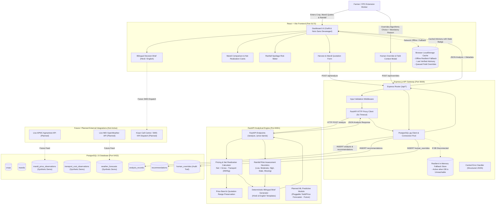

# FasalWindow System Architecture Document
**The 36-Hour Harvest & Selling Decision Co-Pilot for Smallholder Farmers**

---

## 1. Executive Overview

Smallholder farmers across India face critical 24–48 hour decision windows where harvesting standing crops and selecting the destination mandi (market) heavily impacts net household income. The core challenge is multi-dimensional:
1. **Gross vs. Net Realization:** A distant mandi quoting a higher nominal rate often yields lower net income after deducting tractor haulage costs.
2. **Short-Term Rainfall Hazards:** Moisture can trigger immediate grain discoloration, fungal infection, or severe waterlogging in open mandi auction yards.
3. **Rural Connectivity Gaps:** Real-time online access in village fields is sporadic.
4. **Trust & Human Agency:** Extension workers (Kisan Mitras) and FPO aggregators understand localized nuances (e.g., flooded river crossings, trusted commission agents) that algorithms cannot perceive.

**FasalWindow** provides an offline-first, uncertainty-aware decision-support co-pilot that balances net realization against rainfall risk and transit exposure without making fabricated AI claims.

---

## 2. Architecture Diagram

---

## 3. Component Deep Dive

### 3.1 Frontend (`frontend/`)
- **Technology:** React 18, Vite 5, Vanilla CSS, Lucide Icons.
- **Role:** Pure client presentation and field input management. Communicates strictly with the Express API gateway (`/api/*`).
- **Offline Cache:** Serializes the latest verified decision output into browser `localStorage`. When the device loses cellular connectivity or the server is temporarily unreachable, the frontend seamlessly restores the cached advisory with an explicit, high-visibility warning banner showing generation timestamps and input freshness.
- **Bilingual Interface:** Instant tab toggle between Hindi (Devanagari script with Noto Sans) and English.

### 3.2 Express API Gateway (`backend/`)
- **Technology:** Node.js 24, Express 4.19, `pg`, `axios`.
- **Role:** Central gateway, request validator, and orchestrator.
- **FastAPI Proxying:** Connects to `http://127.0.0.1:8001` with strict 5-second timeouts and clear error propagation.
- **PostgreSQL Persistence:** Executes parameterized SQL transactions to store analysis runs, evaluated options, and human overrides.
- **Resilient Fallback:** If the PostgreSQL server is undergoing maintenance or credentials have not been configured, the backend automatically logs the advisory run in an in-memory audit store and continues serving requests with an explicit note, preventing application crashes.

### 3.3 Python Analytical Engine (`ML/`)
- **Technology:** Python 3.13, FastAPI, Pydantic 2.
- **Role:** Mathematical net price deduction, price band interval preservation, rainfall risk categorization, and deterministic bilingual brief compilation.
- **Rule-Based Rigor:** Net realization is calculated strictly via arithmetic:
  $$\text{Net Realization (INR/kg)} = \text{Gross Mandi Price (INR/kg)} - \text{Transport Cost (INR/kg)}$$
- **Uncertainty Bounds:** Preserves price intervals $[G_{\min} - T, G_{\max} - T]$ instead of collapsing them into misleading averages.
- **Extensible ML Design:** Features a clean modular interface so properly evaluated predictive yield or price forecasting models can be plugged in once real-world historical validation data becomes available.

### 3.4 PostgreSQL Database (`database/`)
- **Role:** Persistent store for master crops, regional mandis, synthetic demonstration benchmarks, analysis queries, recommendations, and human override audit trails.
- **Audit Compliance:** Every human override requires a mandatory textual reason, recording original recommendation, chosen alternative, actor identifier, and timestamp.

---

## 4. Uncertainty & Truthful AI Principles

1. **No Fabricated Machine Learning Metrics:** FasalWindow does not present fake R² scores, fictional confidence percentages, or synthetic neural network predictions.
2. **Range Preservation:** When quotes span a range (e.g. ₹24–27/kg), or when secondary sources diverge, the system flags the spread rather than silently averaging it.
3. **Stale Data Safeguards:** Forecasts older than 12 hours are clearly tagged with warning badges.
4. **Missing Weather Fallback:** If weather data is absent, the system gracefully degrades to a price-only comparison with a prominent notification.
5. **Farmer Autonomy:** The system never sells produce automatically or guarantees financial outcomes; all outputs are framed as decision-support advisory.
